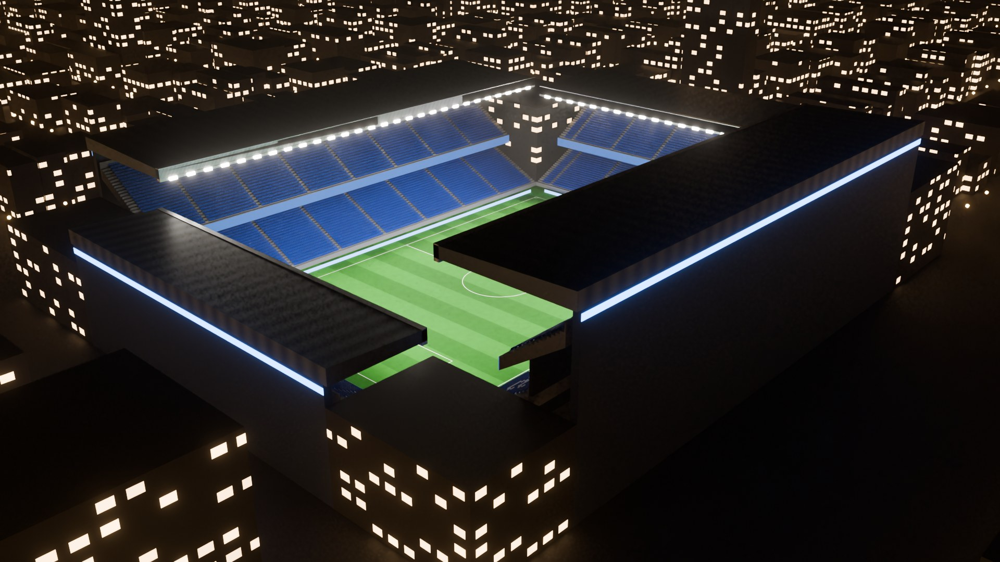

# Stadium: a Stamford Bridge-inspired stadium, built from Python

A night-time stadium reveal for a football game, made entirely by one Python
script driving [Blender](https://www.blender.org/). No modelling by hand: the
pitch, ~32,000 seats, the stands, roofs, floodlights and the city around it
are all generated by `build_stadium.py`.



## The storyboard (20 seconds, 24 fps)

| Frames | Shot |
|---|---|
| 1–150 | High over West London at dusk. The stadium sits dark among the lit windows. |
| 150–186 | **Floodlights snap on**, one stand at a time. |
| 196 | Advertising boards and the blue band round the outside light up. |
| 200–330 | Fly behind the East Stand roof and over its edge into the bowl. |
| 330–480 | Sweep down across the pitch and turn round at pitch level to face *CHELSEA FOOTBALL CLUB* in the seats. |

The stills in `preview/` are frames 40, 205, 330 and 480.

## Run it

You need **Python 3.13**. The `bpy` package only works with the exact Python
version that Blender itself ships with.

```bash
cd stadium
python3.13 -m venv .venv
source .venv/bin/activate          # Windows: .venv\Scripts\activate
pip install bpy pillow

python build_stadium.py                     # build the scene, save stadium.blend
python build_stadium.py --stills            # + render the 4 storyboard stills (1080p)
python build_stadium.py --stills --preview  # quick, half-size test renders
python build_stadium.py --anim              # render all 480 frames to renders/frames/
python build_stadium.py --anim --start 150 --end 200   # just a range
```

Make an MP4 from the frames:

```bash
ffmpeg -framerate 24 -i renders/frames/%04d.png -c:v libx264 -pix_fmt yuv420p -crf 18 stadium.mp4
```

**Or use the Blender app:** open `stadium.blend` to explore the scene, or open
`build_stadium.py` in the *Scripting* tab and press **Run Script**. With a
GPU, set Render Properties → Device → GPU Compute and frames render many times
faster than on a CPU.

## Tweak it

Everything you'd want to change is at the top of `build_stadium.py`:

- `STANDS`: tiers per stand as `(rows, rise per row)`. More rows make a bigger
  stand, and a bigger rise makes it steeper.
- `SEAT_TEXT`: the words spelled out in white seats.
- `SHOTS`: the camera path as `(frame, camera position, look-at point, lens)`.
  Blender smooths between them, easing in and out.
- `LIGHTS_ON`: the frame each stand's floodlights switch on.
- Colours: `SEAT_BLUE`, `GRASS_A/B` and so on, in *linear* RGB (Blender's
  internal colour space, so the values look darker than hex colours).

## How it works (the ideas worth knowing)

- **Instancing:** there is one seat mesh. Each stand stores just a point per
  seat, and Blender draws the seat at every point (`instance_type = "VERTS"`),
  so 32,000 seats cost almost nothing.
- **Profiles:** each tier is a 2D stepped outline (tread, riser, tread...)
  swept along the stand's length (`extrude_profile`).
- **Seat lettering:** text is turned into a 5×7 pixel bitmap (`FONT`), and a
  seat is white if it falls on a "1" pixel, just like real stadium seat art.
- **Procedural materials:** the mowing stripes come from `floor(x / width) mod 2`,
  and city windows from a grid where each cell gets a random number and only
  some light up. There are no image textures anywhere.
- **Light does the work:** a dark sky, warm floodlights, a light haze and a
  bloom glow make a simple model look good.

## Next ideas

- A crowd that fills the seats (instanced people instead of empty seats).
- Pitch lines that draw themselves on.
- Sound: crowd hum, with a hit when the floodlights snap on.
- Export to glTF (`bpy.ops.export_scene.gltf`) to use the stadium in a
  browser/Three.js game.

## A note on branding

This is a personal fan project. Club names, crests and kits are trademarks,
so if the game is ever published or sold, rename the club, change
`SEAT_TEXT`, and don't add official crests or kits.
